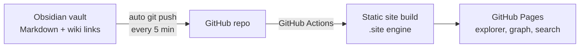

# Blog — a portfolio that shows how I think

**Live:** [sofya0206.github.io/blog-obs](https://sofya0206.github.io/blog-obs/) · written in Russian · updated straight from my Obsidian vault

A CV lists results. It does not show how someone gets there: which observations they notice, how one idea leads to the next, and what they do with a thought once they have it. This site is my attempt to show that part.

It is my Obsidian knowledge base published as a website. Notes, projects and research are linked into one network, so a reader can follow an idea from a diary observation to a principle, and from a principle to a product I built.

## Why build a portfolio this way

**Thinking is a graph, not a list.** My interests look unrelated on paper: AI products, consumer psychology, fashion, money. In my head they are one system. Psychometrics explains why people choose a brand. Agora and Vruchay are products that have to earn that choice. Fashion work taught me to turn analysis into a creative brief. A folder of PDFs cannot show those links. A linked set of notes can, and the site's graph view draws them.

**Ideas must turn into action.** The core principle here is reproducibility: every thought should end in a small action or a test. The diary holds the thoughts, the project pages hold what came out of them, and the links show which led to which.

**It stays alive.** A portfolio site usually gets updated once a year. This one updates whenever I write. Obsidian pushes to GitHub every 5 minutes, and GitHub Pages rebuilds the site.

**It mirrors how I want to work with AI.** A language model is only as good as the knowledge it is grounded in. Keeping my own knowledge structured, linked and public is the same discipline I apply to products: in [Agora](https://github.com/sofya0206/agora-showcase) the AI may only answer from real catalogue data.

## What is inside

### Projects

| Note | What it is |
| --- | --- |
| **Vruchay** | B2B SaaS for named certificates at scale, which I co-founded and lead technically. See [vruchay-showcase](https://github.com/sofya0206/vruchay-showcase). |
| **Agora** | B2B packaging marketplace with grounded AI matching. I am co-founder and wrote the storefront. See [agora-showcase](https://github.com/sofya0206/agora-showcase). |
| **Psychometrics as the basis of marketing strategy** | My independent research. A model of consumer behaviour from perception to emotional attachment, 27 touchpoints a business can control, psychometric indices linked to financial outcomes, and a case study of Skuratov Coffee. |
| **Art direction** | Months of work on a fashion project's content strategy: analysing what worked, writing briefs for creators, and following the work through every stage. |
| **NASTENS** | Three months as a marketing assistant at a fashion brand: analytics and creative decisions for collections. |

### Diary: principles I work by

| Note | The thought |
| --- | --- |
| **Reproducibility** | Every idea has to become an action. Consuming information without reproducing it leads nowhere. |
| **You have to live through the cringe** | Testing any hypothesis means going through an awkward phase first. |
| **Be useful** | Social capital grows when people admire you and are also helped by you. |
| **Income hierarchy** | Executor, intermediary, brand: three ways to earn, and the ceiling of each. Drawn as a diagram from my Obsidian canvas. |

### Notes about the method

- **Why keep notes.** Writing is thinking. Three rules: one note is one thought, a title is a claim and not a topic, and a link matters more than a tag.
- **How this blog works.** A guide to reading the site: sections, links and the graph.

## How to read it

Start on the home page, open any project, then follow the links at the bottom of each note. The graph on the right shows every connection. Search with ⌘K.

## How it works

- I write in Obsidian as usual. Templates create daily and regular notes (⌘⌥T inserts a template, ⌘⇧D opens today's note).
- Git pushes changes every 5 minutes while Obsidian is open.
- A static site generator in `.site` turns notes and `[[wiki links]]` into pages with a folder explorer, a link graph and full-text search.
- Templates, settings, hidden files and this README are not published.
- Live preview: `npm --prefix .site run dev`, then open `http://127.0.0.1:8091/blog-obs/`. It also starts in the background at macOS login (`local.sofia.blog-preview`). Stop that server first if you run it by hand, so port 8091 is free.

## Structure

| Folder | Contents |
| --- | --- |
| `Главная.md` | Home page: who I am and the main projects |
| `Дневник/` | Short observations and principles |
| `Заметки/` | Notes about the method itself |
| `Проекты/` | Development, research and fashion work |
| `Вложения/` | Images and files |
| `Шаблоны/` | Obsidian templates (not published) |

---

Sofia Guliaeva · [github.com/sofya0206](https://github.com/sofya0206)
