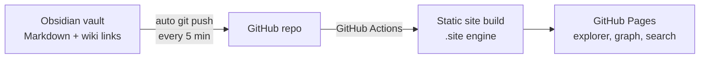

# Blog — a portfolio that shows how I think

**Live:** [sofya0206.github.io/blog-obs](https://sofya0206.github.io/blog-obs/) · in Russian

A CV lists results. This site shows the thinking behind them. It is my Obsidian vault published as a website: notes, projects and research linked to each other, so you can follow how an observation becomes an idea and then a project.

## The idea

- **One note is one thought.** Each title is a claim, not a topic, so every page says something you can agree or disagree with.
- **Links matter more than tags.** Notes are connected by meaning. The graph view shows how my interests in AI products, marketing research and creative strategy feed into each other.
- **Projects next to the thinking.** [Vruchay](https://github.com/sofya0206/vruchay-showcase), [Agora](https://github.com/sofya0206/agora-showcase) and my research paper *Psychometrics in Marketing* sit in the same network as the notes that led to them.
- **Written as I go.** Diary notes are short observations. They are not polished essays, and they show the process.

## How it works

- I write in Obsidian as usual. Templates create daily and regular notes.
- Git pushes changes every 5 minutes while Obsidian is open.
- A static site generator in `.site` turns notes and `[[wiki links]]` into pages with a folder explorer, a link graph and full-text search (⌘K).
- Templates, settings and this README are excluded from the site.
- Local live preview: `npm --prefix .site run dev`, then open `http://127.0.0.1:8091/blog-obs/`.

## Structure

| Folder | What is inside |
| --- | --- |
| Главная | Home page: who I am and the main projects |
| Дневник | Short observations and principles |
| Заметки | Notes about the method itself |
| Проекты | Development, research, fashion and creative work |
| Шаблоны | Obsidian templates (not published) |

---

Sofia Guliaeva · [github.com/sofya0206](https://github.com/sofya0206)
